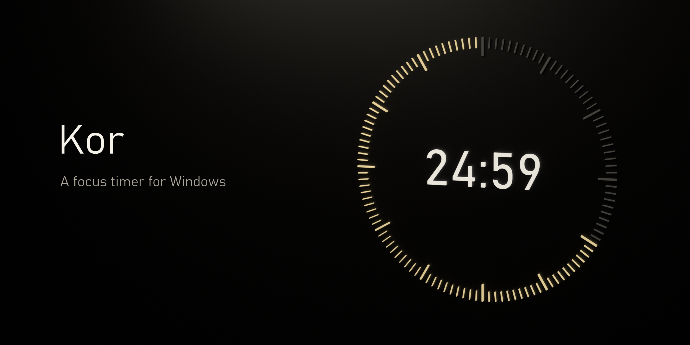
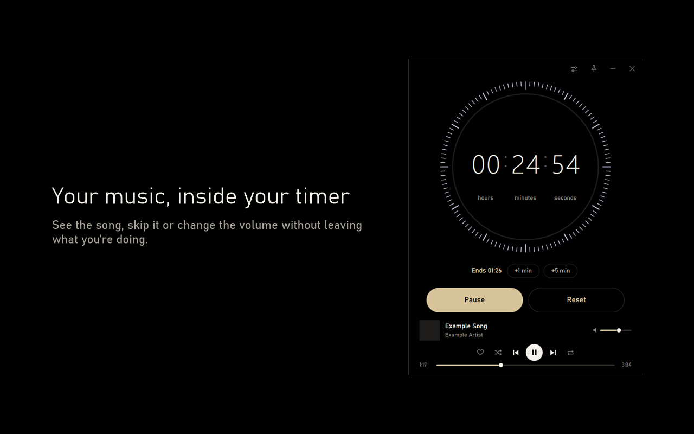

<p align="center"></p>

<p align="center">
  <a href="https://github.com/Talverinhub/Kor/releases/latest/download/Kor.exe"><b>Download for Windows</b></a>
  &nbsp;·&nbsp;
  <a href="README.tr.md">Türkçe</a>
</p>

I noticed I was picking up my phone every ten minutes at work and going out for a cigarette far too often. I love music, I'd like to keep my lungs, and I'd like to keep my job.

So I made Kor, a timer for my desktop. Kor means ember in Turkish. I set it, put on music, and try to stay at my desk until it ends. After testing it for a day or two I was getting more done, so I kept working on it. My friends and I use it now.



## What it does

- Countdown timer with hours, minutes and seconds
- Stopwatch, and a timer that ends after a number of songs
- Daily goal ring
- A small always-on-top timer you can pin to a corner of the screen, resize and fade
- Saved routines, like 50 minutes of work with a Spotify playlist
- Spotify controls inside the app: song, cover, skip, seek and volume
- A question with 20 seconds left: 5 more minutes?
- Optional quiet finish: the music drops, a chime plays and the volume comes back
- Global hotkeys, so you can pause or skip without switching windows
- Notes with tabs, checklists, formatting and search. They attach to the side of Kor or to the top of the mini timer
- A daily summary of your focus time and what you listened to
- Automatic updates
- Turkish and English. Kor follows your Windows language, and you can change it in Settings
- Four themes: Kor, Lavender, Focus for ADHD with one task and progress in parts, and Extreme with points, combos and celebrations
- Optional YouTube Music support through the TalverinConnect browser extension

## How to run it

1. [Download Kor.exe](https://github.com/Talverinhub/Kor/releases/latest/download/Kor.exe).
2. Move it to a folder like Documents.
3. Open it.

It needs Windows 10 or 11. There's nothing to install and no account to create.

Windows will probably show a warning, because the app is new and I don't have a code signing certificate. If you downloaded it from this page, choose **Keep** in your browser, then **More info** and **Run anyway**. Don't run a copy you got from somewhere else.

## Connecting Spotify

The timer works without Spotify, so you can skip this. The music controls need Spotify Premium.

Spotify only allows accounts that are on a developer app's list, and it limits how many fit on one list. So what you do depends on your situation:

| Your situation | What to do |
|---|---|
| Someone told you to just connect | Press **Connect Spotify** on the main screen and allow access in your browser. |
| A friend made their own Spotify app for you | Ask them to add you and send the Client ID. Then follow steps 6 and 7 below. |
| Neither | Follow all the steps below. It's free and takes about five minutes. |

A friend adding your email isn't enough by itself. Kor can't find their app without its Client ID.

1. Open the [Spotify developer dashboard](https://developer.spotify.com/dashboard) and log in.
2. Choose **Create app**. The name and description can be anything.
3. Under **Redirect URIs**, add exactly this and press **Add**:
   ```
   http://127.0.0.1:8888/callback
   ```
4. Tick **Web API**, accept the terms and save.
5. Open the app's settings and copy the **Client ID**.
6. In Kor, open **Settings**, then **Music**, and paste it into **Spotify connection**.
7. On the main screen, press **Connect Spotify** and allow access in your browser.

Then open Spotify on any device and play a song. It shows up in Kor.

To share your app with a friend, add their name and Spotify email under **User Management** in the dashboard and send them the Client ID. Never share the Client Secret. Kor doesn't use it.

Your Spotify login stays encrypted on your computer and isn't sent to me.

## If something goes wrong

- **No song in Kor:** open Spotify on a device and start playing.
- **Spotify refuses the connection:** your account isn't on that app's list. Check that the email added is the one on your Spotify account, and that the right Client ID is in Kor.
- **Spotify says the redirect URI is invalid:** check step 3. It has to be `127.0.0.1`, not `localhost`.
- **Port 8888 is in use:** close the program using it and try again.

## Removing Kor

In **Settings**, choose **Delete my data and remove from startup**, then delete `Kor.exe`.

## Building from source

You need Windows and nothing else. The compiler that comes with Windows is enough. Your build has no built-in Spotify app, so enter your own Client ID in Settings, or put it in a `spotify-kimlik.txt` file in the project folder before building.

```powershell
powershell -ExecutionPolicy Bypass -File .\test.ps1
powershell -ExecutionPolicy Bypass -File .\build.ps1
```

`src/imza.pub.xml` is the key that verifies updates. Replace it only if you publish your own releases.

## Adding a language

Copy `src/diller/en.txt`, name it after the language code, like `de.txt`, and translate the right side of each line. Kor finds the file when you build it, and the language shows up in Settings.

## Privacy

Your settings, routines and focus history stay on your computer. The [privacy policy](privacy-policy.md) has the details.

## License

Kor is open source under the [MIT License](LICENSE). It isn't affiliated with or endorsed by Spotify or YouTube.

## Contact

[Open an issue](https://github.com/Talverinhub/Kor/issues/new/choose) or email talverincontact@gmail.com.
