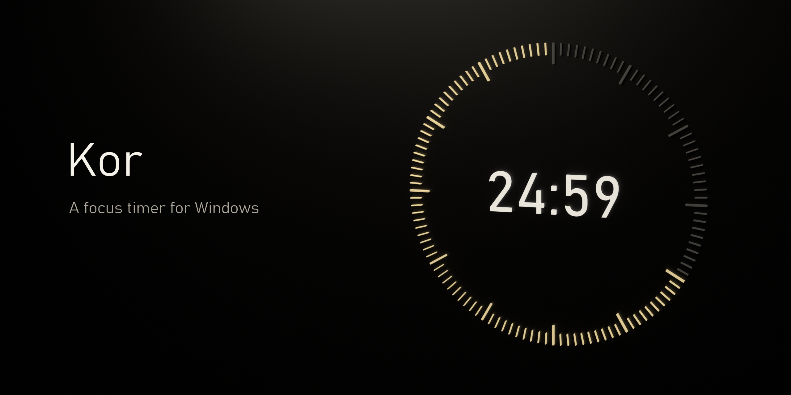
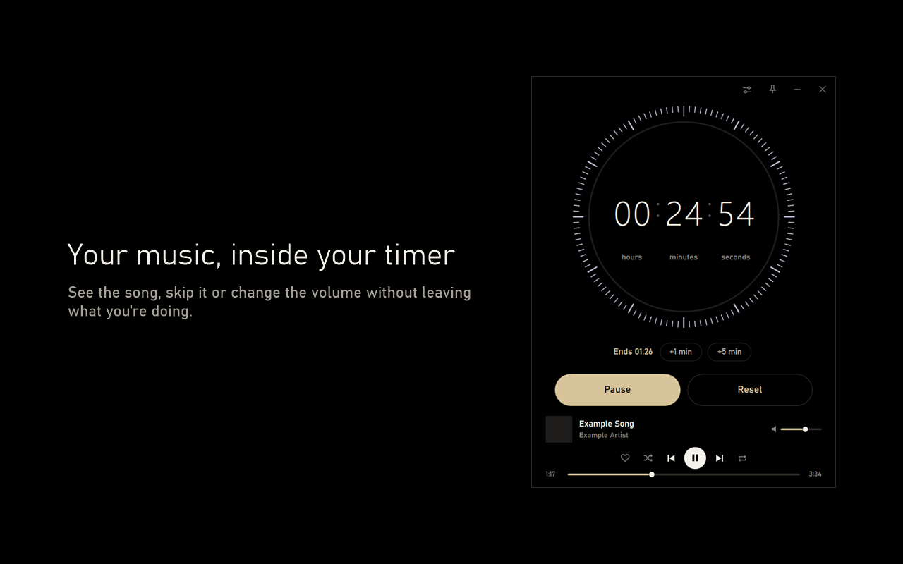

<p align="center"></p>

<p align="center">
  <a href="https://github.com/Talverinhub/Kor/releases/latest/download/Kor.exe"><b>Windows için indir</b></a>
  &nbsp;·&nbsp;
  <a href="README.md">English</a>
</p>

İşte her 10 dakikada bir telefonuma daldığımı ve sürekli sigara molasına çıktığımı fark ettim. Müziği çok seviyorum, ciğerlerimi de seviyorum ve işimden kovulmak istemiyorum.

Bu yüzden masaüstüm için Kor'u yaptım. Süreyi kuruyorum, müziği açıyorum ve bitene kadar masamda kalmaya çalışıyorum. 1-2 günlük denemede verim aldım, ben de geliştirmeye devam ettim. Şimdi arkadaşlarımla beraber kullanıyoruz.



## Neler yapıyor?

- Saat, dakika ve saniyeli geri sayım
- Kronometre ve şarkı sayısına göre biten sayaç
- Günlük hedef halkası
- Ekranın köşesine sabitleyebildiğin, boyutlandırıp saydamlaştırabildiğin, her zaman üstte duran mini sayaç
- Kayıtlı rutinler, örneğin Spotify listesiyle 50 dakika çalışma
- Uygulama içinden Spotify kontrolü: şarkı, kapak, geçme, sarma ve ses
- Son 20 saniyede gelen soru: 5 dakika daha?
- İsteğe bağlı sessiz bitiş: müzik kısılır, çan çalar, ses geri gelir
- Pencere değiştirmeden duraklatıp şarkı geçmeni sağlayan genel kısayollar
- Kor'un yanına veya mini sayacın üstüne yapışan; sekmeli, yapılacaklar listeli, biçimlendirilebilen ve aranabilen notlar
- Odak süren ve dinlediklerinle günlük özet
- Otomatik güncelleme
- Türkçe ve İngilizce. Kor, Windows dilini izler, Ayarlar'dan değiştirebilirsin
- TalverinConnect tarayıcı eklentisiyle isteğe bağlı YouTube Music desteği

## Nasıl çalıştırılır?

1. [Kor.exe dosyasını indir](https://github.com/Talverinhub/Kor/releases/latest/download/Kor.exe).
2. Belgeler gibi kalıcı bir klasöre taşı.
3. Aç.

Windows 10 veya 11 gerekir. Kurulum yok, hesap açmak da gerekmiyor.

Uygulama yeni olduğu ve kod imzalama sertifikam olmadığı için Windows büyük ihtimalle uyarı gösterecek. Dosyayı bu sayfadan indirdiysen tarayıcıda **Tut**, sonra **Ek bilgi** ve **Yine de çalıştır** seçeneklerini kullan. Başka bir yerden aldığın kopyayı çalıştırma.

## Spotify'ı bağlama

Sayaç Spotify olmadan da çalışır, bu bölümü atlayabilirsin. Müzik kontrolleri için Spotify Premium gerekir.

Spotify yalnızca bir geliştirici uygulamasının listesindeki hesaplara izin verir ve bir listeye sığan kişi sayısını sınırlar. Bu yüzden ne yapacağın durumuna bağlı:

| Durumun | Ne yapacaksın |
|---|---|
| Biri sana sadece bağlanmanı söyledi | Ana ekranda **Spotify'a bağlan** düğmesine bas ve tarayıcıda izin ver. |
| Arkadaşın senin için kendi Spotify uygulamasını açtı | Seni eklemesini ve Client ID'yi göndermesini iste. Sonra aşağıdaki 6. ve 7. adımları izle. |
| İkisi de değil | Aşağıdaki tüm adımları izle. Ücretsizdir, yaklaşık beş dakika sürer. |

Arkadaşının mail adresini eklemesi tek başına yetmez. Kor, onun uygulamasını Client ID olmadan bulamaz.

1. [Spotify geliştirici paneline](https://developer.spotify.com/dashboard) gir.
2. **Create app** seçeneğine bas. Ad ve açıklama önemli değil.
3. **Redirect URIs** alanına tam olarak şunu yaz ve **Add** düğmesine bas:
   ```
   http://127.0.0.1:8888/callback
   ```
4. **Web API** kutusunu işaretle, koşulları kabul et ve kaydet.
5. Uygulamanın ayarlarını aç ve **Client ID** değerini kopyala.
6. Kor'da **Ayarlar** ve **Müzik** bölümünü aç, kimliği **Spotify bağlantısı** alanına yapıştır.
7. Ana ekranda **Spotify'a bağlan** düğmesine bas ve tarayıcıda izin ver.

Sonra herhangi bir cihazda Spotify'ı açıp şarkı başlat. Şarkı Kor'da görünür.

Uygulamanı bir arkadaşınla paylaşmak için paneldeki **User Management** bölümüne adını ve Spotify mailini ekle, sonra ona Client ID'yi gönder. Client Secret'ı asla paylaşma, Kor onu kullanmıyor.

Spotify girişin bilgisayarında şifreli durur ve bana gönderilmez.

## Bir sorun çıkarsa

- **Kor'da şarkı görünmüyor:** Bir cihazda Spotify'ı açıp çalmaya başla.
- **Spotify bağlantıyı reddediyor:** Hesabın o uygulamanın listesinde değil. Eklenen mailin Spotify hesabındaki mail olduğunu ve Kor'da doğru Client ID'nin yazdığını kontrol et.
- **Spotify yönlendirme adresinin geçersiz olduğunu söylüyor:** 3. adımı kontrol et. Adres `localhost` değil, `127.0.0.1` olmalı.
- **8888 bağlantı noktası kullanımda:** Onu kullanan programı kapatıp yeniden dene.

## Kor'u kaldırma

**Ayarlar** bölümünde **Verilerimi sil ve başlangıçtan kaldır** seçeneğine bas, sonra `Kor.exe` dosyasını sil.

## Kaynaktan derleme

Windows dışında bir şey gerekmez. Windows ile gelen derleyici yeterli. Kendi derlemende yerleşik Spotify uygulaması olmaz; Client ID'ni Ayarlar'a gir ya da derlemeden önce proje klasöründe `spotify-kimlik.txt` dosyasına yaz.

```powershell
powershell -ExecutionPolicy Bypass -File .\test.ps1
powershell -ExecutionPolicy Bypass -File .\build.ps1
```

`src/imza.pub.xml` güncellemeleri doğrulayan anahtardır. Yalnızca kendi sürümlerini yayınlayacaksan değiştir.

## Yeni dil ekleme

`src/diller/en.txt` dosyasını kopyala, adını dil koduyla değiştir (`de.txt` gibi) ve her satırın sağ tarafını çevir. Kor derlenirken dosyayı bulur, dil Ayarlar'da görünür.

## Gizlilik

Ayarların, rutinlerin ve odak geçmişin bilgisayarında kalır. Ayrıntılar için [gizlilik politikasını](gizlilik-politikasi.md) oku.

## Lisans

Kor, [MIT Lisansı](LICENSE.tr.md) ile açık kaynaktır. Spotify veya YouTube ile bağlantılı değildir ve onlar tarafından onaylanmamıştır.

## İletişim

[Sorun aç](https://github.com/Talverinhub/Kor/issues/new/choose) veya talverincontact@gmail.com adresine yaz.
